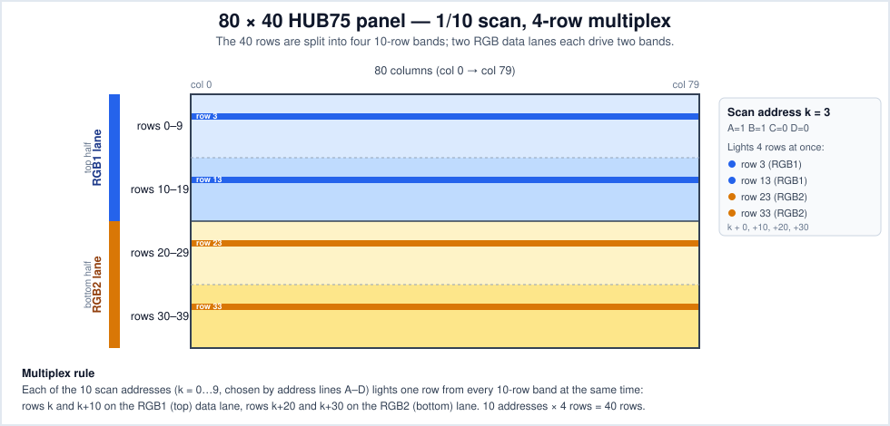
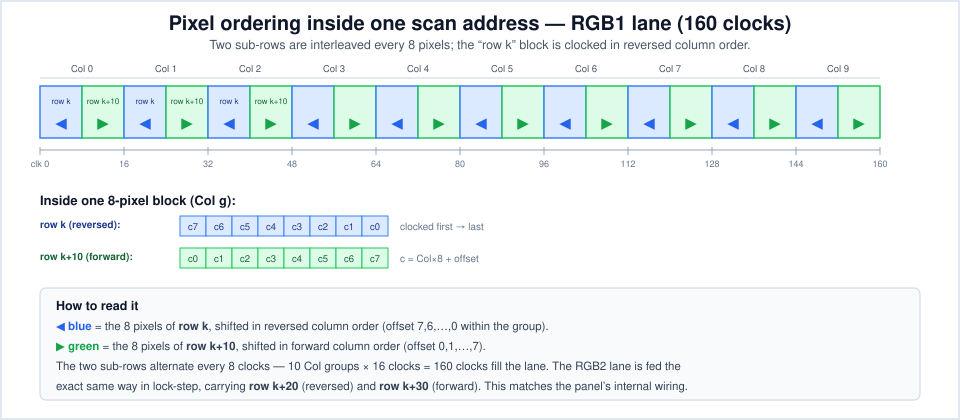
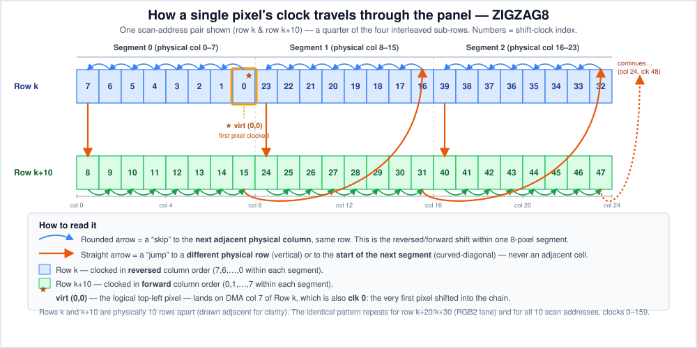

# 80×40 4-scan HUB75 panel (ZIGZAG8 / 8-pixel-segment reversal)

This documents a custom **80×40, 1/10-scan** HUB75 LED panel whose driver ICs fold two logical rows into one 160-long shift register per color lane and mirror the column order inside every 8-LED block.

With the refactored [`VirtualMatrixPanel_T`](../src/ESP32-HUB75-VirtualMatrixPanel_T.hpp), this wiring is supported natively via [`FourScan80x40_ZigZag8`](../src/ESP32-HUB75-VirtualMatrixPanel_T.hpp) — an alias for:

```cpp
FourScanMapping<8, FOUR_SCAN_ZIGZAG_SM16208, 40>
// where FOUR_SCAN_ZIGZAG_SM16208 = FOUR_SCAN_SWAP_BLOCKS | FOUR_SCAN_REVERSE_LEFT
```

This panel's SM16208 constant-current driver ICs latch data on the inverted shift clock, so set `mxconfig.clkphase = false;`.

## Built-in example: 80×40 ZIGZAG8 panel

```cpp
#include <ESP32-HUB75-MatrixPanel-I2S-DMA.h>
#include <ESP32-HUB75-VirtualMatrixPanel_T.hpp>

#define PANEL_RES_X 80
#define PANEL_RES_Y 40

using PanelScan      = FourScan80x40_ZigZag8;
using VirtualDisplay = VirtualMatrixPanel_T<CHAIN_NONE, PanelScan>;

MatrixPanel_I2S_DMA *dma_display = nullptr;
VirtualDisplay *panel = nullptr;

void setup() {
  Serial.begin(115200);

  // Automatically configures a folded 160x20 DMA surface from 80x40 + PanelScan traits.
  HUB75_I2S_CFG mxconfig = VirtualDisplay::makeDMAConfig(PANEL_RES_X, PANEL_RES_Y);
  mxconfig.clkphase = false; // SM16208 latches on the inverted shift clock

  dma_display = new MatrixPanel_I2S_DMA(mxconfig);
  dma_display->begin();
  dma_display->setBrightness8(90);
  dma_display->clearScreen();

  panel = new VirtualDisplay(*dma_display, 1, 1, PANEL_RES_X, PANEL_RES_Y);
}

void loop() {
  for (int y = 0; y < panel->height(); y++) {
    for (int x = 0; x < panel->width(); x++) {
      panel->drawPixel(x, y, panel->color565(255, 0, 0));
      delay(5);
    }
  }
  delay(1000);
  dma_display->clearScreen();
}
```

### Equivalent Custom `ScanPolicy` Contract

For panels requiring custom coordinate math beyond `FourScanMapping` flags, policies inherit `ScanPolicyTraits<DmaWidthMult, DmaHeightDiv>` and implement `VirtualCoords map(VirtualCoords, const PanelGeometry&) const`:

```cpp
struct SM16208ZigZagMapping : ScanPolicyTraits<2, 2> {
  static constexpr int kPixelBase = 8;

  constexpr VirtualCoords map(VirtualCoords coords, const PanelGeometry &geom) const noexcept {
    const int panel_idx  = coords.x / geom.panel_res_x;
    const int local_x    = coords.x % geom.panel_res_x;
    const int row_group  = coords.y / (geom.panel_res_y / 4); // 0..3
    const int col_group  = local_x / kPixelBase;
    const int col_within = local_x % kPixelBase;

    int mapped_x = col_group * (kPixelBase * 2);
    mapped_x += ((row_group % 2) == 0)
                    ? ((kPixelBase - 1) - col_within)
                    : (kPixelBase + col_within);

    const int half_h = geom.panel_res_y / 2;
    const int q_h    = half_h / 2;
    coords.x = static_cast<int16_t>(panel_idx * (geom.panel_res_x * 2) + mapped_x);
    coords.y = static_cast<int16_t>((coords.y / half_h) * q_h + (coords.y % q_h));
    return coords;
  }
};
```

> **Note:** `VirtualDisplay::makeDMAConfig(80, 40)` enforces the folded **160×20** DMA surface automatically so rows 20–39 (RGB2) and right-half segments (`x >= 80`) are never dropped.

---

## The panel at a glance

| Property              | Value                                                     | Notes                              |
| --------------------- | --------------------------------------------------------- | ---------------------------------- |
| Resolution            | **80 × 40** pixels                                        | logical addressable area           |
| Scan rate             | **1/10** (10 address values cycled per frame)             | `A…D` select 1 of 10 addresses     |
| Rows lit per address  | **4** (a "4-scan" panel)                                  | `k`, `k+10`, `k+20`, `k+30`        |
| Address lines         | **A, B, C, D** (no E)                                     | 4 bits cover the 10 addresses      |
| Data lanes            | **2** — RGB1 (top half) + RGB2 (bottom half)              | `R1/G1/B1` and `R2/G2/B2`          |
| Shift chain per lane  | **160 clocks** = 80 cols × 2 sub-rows                     | 10 groups × (8 + 8)                |
| Quirk                 | **8-pixel-segment column reversal**, asymmetric per phase | offsets 7→0 vs 0→7                  |

This is a common "outdoor module" arrangement: a physically 80×40 panel whose driver ICs fold **two logical rows into one 160-long shift register per colour lane**, and mirror the column order inside every 8-LED block. None of this is standard 1/16-scan HUB75, which is why the pixel order has to be remapped.

---

## Panel organization

The 40 rows split into four contiguous 10-row **bands**. Two RGB data lanes each own two bands; the four bands are addressed together, one row each, by the same scan address `k`.



**Multiplex rule.** For scan address `k` (0…9, set on A–D):

- **RGB1 lane** (top half) shows **row `k`** and **row `k+10`**.
- **RGB2 lane** (bottom half) shows **row `k+20`** and **row `k+30`**.

Four physical rows are lit at once; ten addresses cover all 40 rows. Within a lane the two rows are distinguished not by address but by *where in the 160-clock shift they land* (see *Pixel ordering* below).

---

## Pixel ordering inside one scan address

This is the heart of the panel. Each 160-clock lane is **not** "row `k` then row `k+10`" in two 80-pixel halves. Instead the two sub-rows are **interleaved every 8 pixels**, and the `k` block is clocked in **reversed** column order:



For each of the 10 column groups (`Col` = 0…9), the panel expects the two multiplexed sub-rows clocked in two back-to-back 8-clock phases — one reversed, one forward. So within one 8-pixel group the chain carries `row k` reversed (offsets 7→0), then `row k+10` forward (offsets 0→7) — 16 clocks — repeated for 10 groups = 160 clocks. RGB2 rides the same clocks carrying `k+20` / `k+30`.

The reversal is asymmetric (one sub-row reversed, the other forward) because the panel wires its two multiplexed sub-rows in mirror-image order inside each 8-LED module; compensating in software makes both scan left-to-right on screen.

### Tracing a single pixel's path

The diagram below walks the same 16-clock, one-segment-at-a-time pattern described above, but cell by cell — one scan-address pair (row `k` / row `k+10`, a quarter of the four interleaved sub-rows), three 8-pixel segments:



Rounded arrows are the "skip" to the next adjacent physical column within a segment (reversed on row `k`, forward on row `k+10`); straight arrows are the "jump" to a different physical row or into the next segment — never an adjacent cell. The clock numbers in each cell confirm the order matches the zigzag described above. The gold-outlined cell marks `panel->drawPixel(0, 0, ...)` — logical `(0,0)` lands on DMA col 7 of row `k`, which is also clock 0: the very first pixel shifted into the chain.
